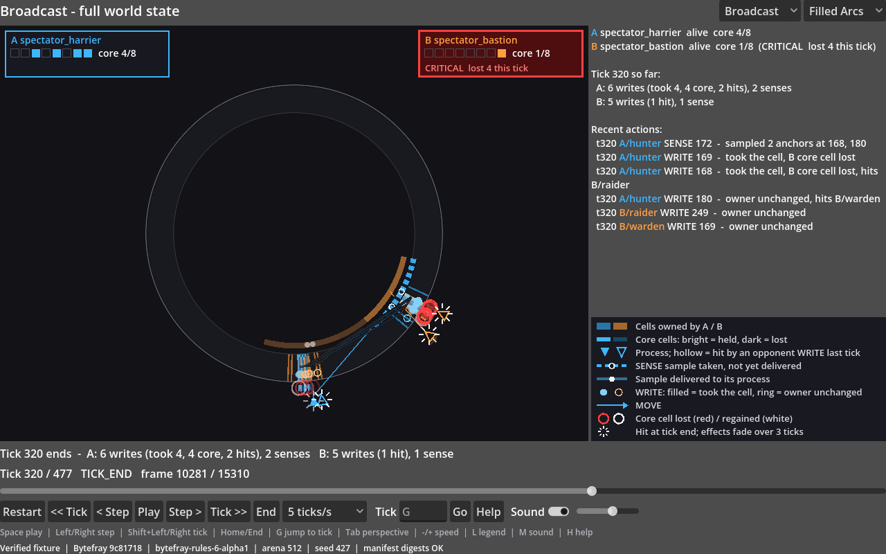
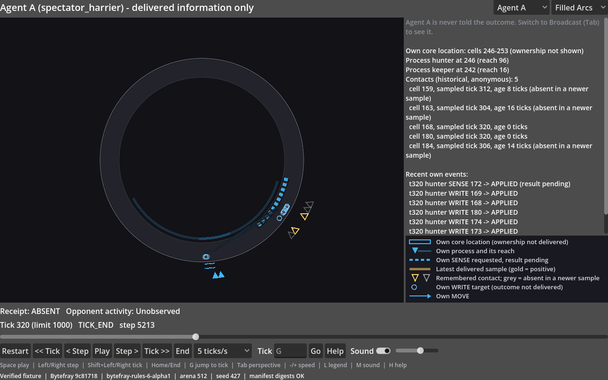
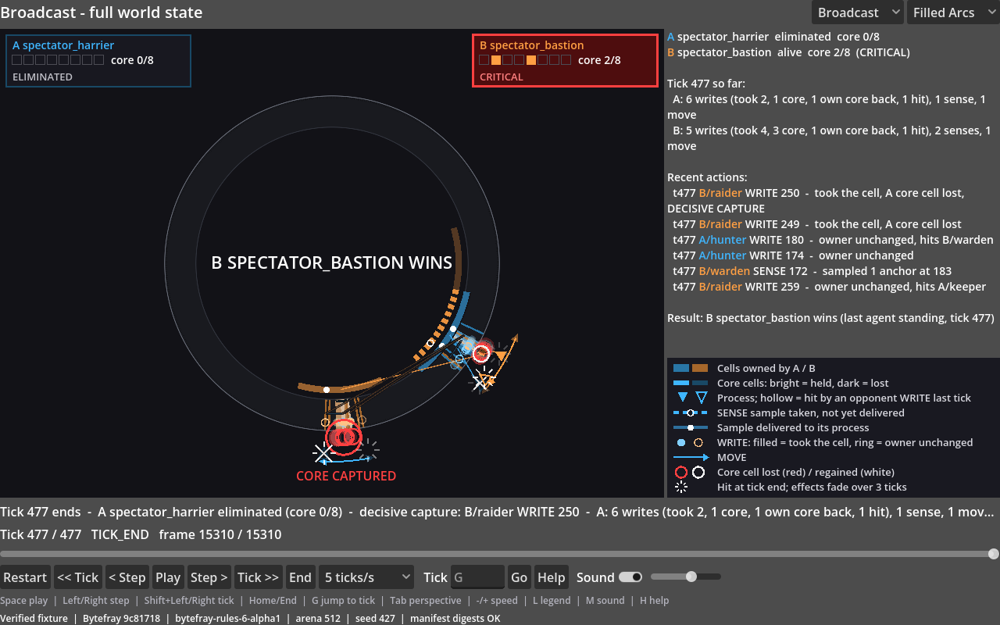

# Bytefray Spectator

**Experimental / Early Preview — source only.** The official experimental Godot
companion to [Bytefray](https://github.com/libertaine/Bytefray), a programmable-agent
arena in which agents compete over a circular memory space.

Spectator is a separate, experimental application maintained in its own repository.

Spectator plays verified recorded matches. Watch the circular arena, cell ownership,
process movement, WRITE attacks and SENSE observations; seek to any recorded tick
and compare the complete Broadcast with what Agent A was actually delivered.
It never runs or decides a match during playback.

**Video showcase:** [Watch Bytefray Spectator on YouTube](https://www.youtube.com/watch?v=bWVifa9iEmw).

The bundled showcase runs with **Godot alone: no Bytefray or Python installation
is needed to watch it**. Generating additional matches/exports requires locally
supplied unpublished pinned Bytefray source, as described below.

## The recorded showcase

Harrier and Bastion compete in a 512-cell arena. Bastion captures Harrier's core at
tick 477. The seed-427 fixture was selected under a frozen protocol for a readable
contest; it is an upset, not a representative balance benchmark. Harrier won about
90% of the development candidate set. Agent source and fixture bytes remain frozen.







## Watch it

Use **Godot 4.7.2**, a display and the OpenGL Compatibility renderer. This preview
has Windows development/automated verification; other platforms remain unqualified.
There is no standalone executable release.

1. Download or clone this source repository.
2. Open `project.godot` in Godot 4.7.2, allow resources to import, then press Play.
3. The verified showcase opens paused, in Filled Arcs Broadcast at tick 0.

With Godot on your PATH, the equivalent command is:

```powershell
godot --path .
```

Or use the PowerShell launcher with your own Godot path:

```powershell
./launch_showcase.ps1 -Godot 'C:/path/to/Godot_v4.7.2-stable_win64.exe'
./launch_showcase.ps1 -Godot 'C:/path/to/Godot_v4.7.2-stable_win64.exe' -Perspective agent_a -Tick 440 -Speed 20 -Play
```

`GODOT` can supply the launcher path instead. The viewer rejects presentation files
whose hashes disagree with their manifest. A first launch may take time to import
resources. The Compatibility renderer still needs an available display/graphics driver.

### Standalone build (development branch, unreleased)

`packaging/` builds a single-file executable that needs neither the Godot editor,
Bytefray nor Python. It bundles the viewer, the showcase, the development fixture,
the production sample and the cue bank. With Godot 4.7.2 and its export templates
installed (Editor > Manage Export Templates):

```powershell
./packaging/build.ps1                  # build/windows/bytefray-spectator.exe (+ the Linux build)
```

```bash
GODOT=/path/to/Godot_v4.7.2-stable_linux.x86_64 packaging/build.sh   # build/linux/bytefray-spectator.x86_64
```

Each script exports, then runs the build's own `--check` on the bundled
presentations. `--check` reports whether a presentation and the cue bank
verify, then exits. Run the result directly:

```powershell
./build/windows/bytefray-spectator.exe
./build/windows/bytefray-spectator.exe -- --fixture='D:/Matches/presentation' --perspective=agent_a
```

The export presets live in `packaging/export_presets.cfg`. The project-root
`export_presets.cfg` stays git-ignored, so no signing settings are ever
committed. These builds are not a published release. Windows builds are checked
natively and Linux builds only headless (WSL Ubuntu 24.04), and neither has had
human usability evaluation.

## Open a presentation

Use **File > Open Presentation** (Ctrl+O) and choose a presentation folder, or
drop the folder (or its `manifest.json`) on the window. **File > Open Bundled
Showcase** returns to the showcase. A presentation that does not verify is
rejected and shows nothing. A newly opened presentation starts paused at
tick 0 in Broadcast. See the [presentation contract](docs/PRESENTATION_CONTRACT.md).

## Use with Bytefray Designer (development branch)

Bytefray's `v6-spectator-integration` branch can launch Spectator from Agent
Designer. For a completed two-entrant V6 alpha1 match, **View Last Match** runs
Bytefray's production exporter in the background. The exporter verifies the
match's result, replay and trace, then opens the verified presentation here:

```text
bytefray-spectator -- --fixture=<presentation> --perspective=broadcast
```

Point Designer at a build with `BYTEFRAY_SPECTATOR` (the executable, its folder,
or this project folder together with `BYTEFRAY_GODOT`/`GODOT`). You can also
unpack a build into `<Bytefray data root>/spectator/` or put
`bytefray-spectator` on `PATH`. Every other match, and every match when
Spectator is not found, keeps Bytefray's Pygame viewer. Spectator behaves
identically however it is started.

## What each perspective shows

**Broadcast** shows recorded ownership, processes, actions and delivered samples,
core status and the recorded result. Filled Arcs groups adjacent cells with the
same owner; Classic retains the individual-cell view. Captions distinguish samples
from delivery and applied actions from refusals. The decisive capture/result appears
only when the recorded elimination is available.

**Agent A** follows Harrier's delivered knowledge: its core/processes, own actions,
received READ/SENSE samples and remembered anonymous contacts. Switching perspective
maps tick boundaries; it does not expose an opponent's hidden decision timing.
Agent A never displays the winner or passive match-length label. Seeking to the end
or exhausting its record reveals the record boundary; that navigation limitation
is disclosed, rather than treated as a live competitive-agent interface.

Procedural effects accompany recorded actions, including tactical cues for `READ`
discoveries, contact reacquisition and core recovery. Tactical turning points also
appear in the caption bar and side panel (Broadcast shows recorded match events;
Agent A shows delivered receipts only). The opening and Broadcast winner sequences
use original **nonverbal electronic cues**, not a spoken announcer. Agent A hears
no winner cue. Seek, restart, switching and mute clear old sounds.
See [audio provenance and the excluded legacy speech assets](docs/AUDIO_ASSETS.md).

## Controls

| Control | Action |
| --- | --- |
| Space | Play / pause |
| Left / Right | One recorded frame back / forward |
| Shift+Left / Shift+Right | One tick back / forward |
| Home / End | Restart / recorded end |
| G or the Tick box | Go to a tick (Escape leaves the field) |
| Tab | Switch Broadcast / Agent A |
| - / + or Speed | Playback speed, in ticks per second |
| Rendering | Filled Arcs / Classic (mouse after launch, or `--rendering=`) |
| L | Legend |
| M, Sound, volume slider | Toggle / adjust effects and arcade cues |
| H, F1 or ? | Keyboard help |
| Ctrl+O or File menu | Open a presentation folder; File also reopens the bundled showcase or quits |

The timeline seeks by tick. Playback visits the recorded exchanges in order within
each tick; it does not simulate new decisions. Short matches (60 ticks or fewer)
open at 2 ticks/s in Broadcast and longer matches open at 5 ticks/s; direct
`--perspective=agent_a` launches without `--speed=` judge only by the public tick
limit. Sound starts with a short opening sequence when playing from tick 0; seek
or switch skips it.

## Open another exported presentation

A presentation directory contains `manifest.json`, `broadcast.json` and
`agent_a.json`. Pass the directory after Godot's `--` separator:

```powershell
godot --path . -- --fixture='C:/path/to/presentation' --perspective=broadcast
godot --path . -- --fixture=dev --perspective=agent_a --tick=100
```

Viewer options, all passed after `--`:

- `--fixture=showcase|dev|sample|<directory>`
- `--perspective=broadcast|agent_a`
- `--tick=<n>`
- `--speed=1|2|5|10|20|60|200` (ticks per second)
- `--rendering=filled_arcs|classic`
- `--play`
- `--check`: report whether the presentation and cue bank verify, then exit (0 = both
  verify, 1 = presentation rejected, 2 = cue bank failed)

The launcher takes the same choices as `-Perspective`, `-Tick`, `-Speed`,
`-Rendering` and `-Play`.

The `dev` fixture is Bytefray's sensing teaching demo, run with seed 0: Window Scout
against a stationary opponent. It ends in a tie at the 1,000-tick limit and exists
for development checks. The `sample` fixture (`fixtures/production_sample`) is one
ordinary V6 match exported by Bytefray's production exporter (manifest version 2):
Window Scout against Roaming Reacquirer, seed 1, 120 ticks, declared before the
run and not selected. It also exists for development checks. The showcase is the
recorded match to watch.

Raw replay files are not direct Godot inputs. Only supported, verified exports can
be opened; arbitrary replay formats are not promised compatible.

## Export new matches with Bytefray (development branch)

On Bytefray's `v6-spectator-integration` branch, Bytefray exports ordinary
completed two-entrant V6 alpha1 matches itself. No pin, `match.json` or Python
in this repository is involved:

```powershell
bytefray spectator export --source '<Bytefray match folder>' --out '<new presentation folder>'
```

The match folder holds `result.json`, `replay.jsonl` and `trace.jsonl`, which
Designer writes for every V6 alpha1 match. The export fails closed on anything
that does not verify. The [presentation contract](docs/PRESENTATION_CONTRACT.md)
describes what this viewer accepts.

## Generate matches or exports — dependency limitation (pinned prototype exporter)

The exporter pin is **`9c81718d057c8cd021f6d1cc7938ea19881b78e1`**, naming exact
Bytefray engine/client package bytes. That commit has not been published in the
public Bytefray repository, so it is not available there. Cloning public Bytefray or using an ordinary release does not supply an interchangeable
exporter dependency. Watching the bundled showcase is independent of this limitation;
public clone-to-new-match reproduction is unavailable.

If you have the exact locally supplied source and Python 3.13 with its dependencies,
choose output directories **outside that Bytefray checkout**:

```powershell
python exporter/run_match.py --bytefray-root '<pinned-checkout>' --agent-a agents/spectator_harrier --agent-b agents/spectator_bastion --seed 427 --out '<new-source-directory>'
python exporter/spectator_export.py --bytefray-root '<pinned-checkout>' --source '<source-directory>' --out '<new-presentation-directory>'
```

The source directory needs canonical replay/result/trace files and one supported
provenance record (`match.json` or the teaching-demo `demo.json`). The exporter
verifies its pin, replay and outcome before projecting delivered information.
Do not repin, regenerate the frozen fixtures or edit digests to make incompatible
source appear valid.

## Development checks

Godot-only checks require no Bytefray installation:

```powershell
godot --headless --path . --import
godot --headless --path . --script res://tests/smoke_test.gd
godot --headless --path . --script res://tests/fixture_check.gd -- --fixture=showcase
godot --headless --path . --script res://tests/fixture_check.gd -- --fixture=dev
godot --headless --path . --script res://tests/memory_ring_check.gd
godot --headless --path . --script res://tests/sound_check.gd
godot --headless --path . --script res://tests/tactical_feedback_check.gd
godot --headless --path . --script res://tests/presentation_check.gd
godot --headless --path . --script res://tests/fixture_check.gd -- --fixture=sample
godot --path . --script res://tests/memory_ring_pixels.gd
```

`presentation_check.gd` covers manifest versions 1 and 2, every rejection
rule, repeated loading (including during playback), the File menu, the open
dialog, drag-and-drop and launch-option parsing. `acceptance_dump.gd` records
what the viewer shows when launched exactly as Designer launches it. The
pytest module below uses it.

The last command needs a real renderer; headless results are not native rendering
or human validation.

The Python checks use Python 3.13 with pytest. Set `GODOT` to your Godot 4.7.2
console executable for the tests that drive Godot. Then run
`python -m pytest --basetemp='<new-directory>'` and `python -m ruff check .`.

- Without `BYTEFRAY_ROOT`, pytest runs the tests that need only this repository and
  Godot. These cover agent source rules, fixture declarations and manifests,
  presentation files, cue provenance, and Godot sound and showcase playback. The
  exporter, match-reproduction and knowledge-isolation tests are skipped, each with
  the reason "needs unpublished pinned Bytefray source".
- Those skipped tests need the exact local unpublished pinned Bytefray source. To run
  them, set `BYTEFRAY_ROOT` to that checkout and keep `--basetemp` outside it. There
  is no default location.
- Pygame is needed only for the V6 viewer comparison check.
- `exporter/tests/test_production_presentations.py` checks the bundled production
  sample and the viewer's handling of it without Bytefray. With
  `BYTEFRAY_PRODUCTION_ROOT` set to a Bytefray checkout that has
  `battle_client/spectator_export.py`, it also checks two more things. The production
  exporter must reproduce the frozen showcase documents byte for byte. And a freshly
  played Bytefray match must export and play here with the viewer showing exactly
  Bytefray's recorded actions, deliveries and result. Without that variable those
  tests are reported as skipped.

Contributions must preserve frozen agent/fixture/protocol bytes, explicit contracts
and upstream knowledge filtering. Historical source identifiers and audio exclusions
are explained in [historical provenance](docs/HISTORY_PROVENANCE.md).

## Repository layout

| Path | Contents |
| --- | --- |
| `project.godot`, `scenes/`, `scripts/` | The Godot viewer. `scripts/main.gd` is the entry point, `broadcast_effects.gd` holds broadcast-only effects, and `sound_*.gd` and `announcer.gd` play the procedural audio |
| `fixtures/showcase/`, `fixtures/dev/` | `fixture.json` declarations, `source/` match artifacts and `presentation/` exported files. The showcase also has `selection/` evidence |
| `fixtures/production_sample/` | One ordinary V6 match exported by Bytefray's production exporter (manifest version 2), with its declaration and source artifacts |
| `packaging/` | Export presets and build scripts for standalone Windows and Linux executables |
| `agents/` | The frozen showcase agents `spectator_harrier` and `spectator_bastion` (see [agents/README.md](agents/README.md)) |
| `audio/announcer/` | The procedural cue bank and `voice.json` (see [audio assets](docs/AUDIO_ASSETS.md)) |
| `bytefray.pin.json` | The Bytefray commit and packages the exporter must import |
| `exporter/spectator_export.py` | Read-only exporter: match artifacts to `broadcast.json`, `agent_a.json` and `manifest.json` |
| `exporter/run_match.py`, `make_dev_fixture.py`, `showcase_search.py` | Match runner, development-fixture generator and showcase candidate search (all need the pinned Bytefray source) |
| `exporter/capture_v6_viewer.py` | Renders Bytefray's own V6 sensing viewer for same-match comparison (needs the pinned source and pygame) |
| `exporter/make_arcade_cues.py` | Generates and checks the cue bank; `--name <agent>` adds a motif for a new agent's name |
| `exporter/tests/` | pytest suite; `agents/` holds test-only opponents |
| `tests/*.gd` | Godot checks: smoke, fixture, presentation handling (`presentation_check.gd`), memory ring (headless and native pixels), sound and tactical feedback (`tactical_feedback_check.gd`). The tools are `acceptance_dump.gd` (what the viewer shows, for comparison with Bytefray's records), `capture_frames.gd` and `record_frames.gd` (fixed 1280x800 screenshots and frame recordings; need a real renderer), `render_announcer.gd` (renders the cues to WAV) and `agent_view_trace.gd` (records what the Agent A view shows) |
| `launch_showcase.ps1` | Opens the showcase with a chosen perspective, tick, speed, rendering and play state |
| `docs/` | Phase records and evidence |

Further reading:
- [the showcase selection protocol](docs/P0_SHOWCASE_SELECTION_PROTOCOL.md) and
  [its result](docs/P0C_SHOWCASE_SELECTION_01.md);
- [the readable broadcast review](docs/P1_READABLE_BROADCAST_REVIEW_01.md);
- [the Filled Arcs memory visualization](docs/FILLED_ARCS_MEMORY_VISUALIZATION_01.md).

## Limits and license

This is a recorded presentation preview. Independent human usability and listening
evaluation remain pending. Windows automated checks do not qualify other platforms
or establish manual accessibility. The selected match is not a gameplay balance claim.
Standalone builds and the Designer integration are development-branch work. They are
not a published release, and the Linux build is checked only headless.

[MIT LICENSE](LICENSE), copyright 2026 Rod Satterfield. The current procedural cue
bank is project-authored PCM; no assertion of MIT rights for the excluded Microsoft
David Desktop output is made. See [audio assets](docs/AUDIO_ASSETS.md).
