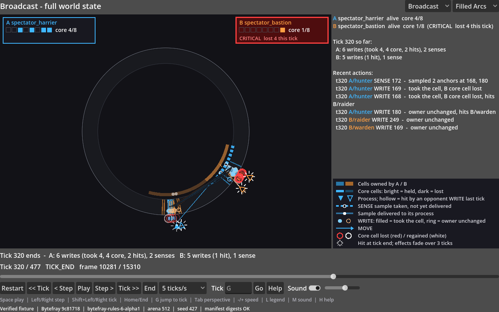
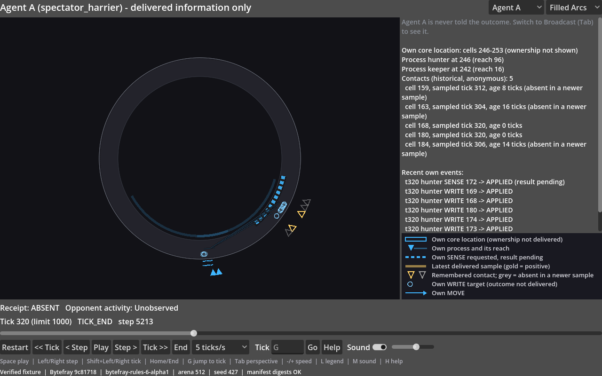
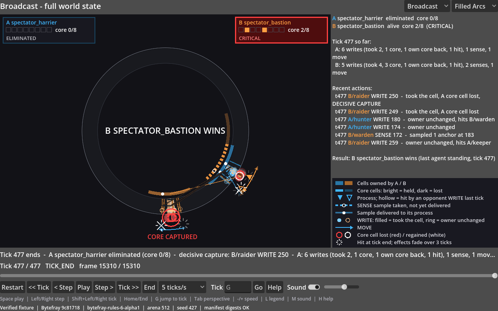

# Bytefray Spectator

**Experimental / Early Preview — source only.** The official experimental Godot
companion to [Bytefray](https://github.com/libertaine/Bytefray), a programmable-agent
arena in which agents compete over a circular memory space.

Spectator is a separate, experimental application maintained in its own repository.

Spectator plays verified recorded matches. Watch the circular arena, cell ownership,
process movement, WRITE attacks and SENSE observations; seek to any recorded tick
and compare the complete Broadcast with what Agent A was actually delivered.
It never runs or decides a match during playback.

**Video showcase:** [Watch Bytefray Spectator on YouTube](https://www.youtube.com/watch?v=bWVifa9iEmw).

The bundled showcase runs with **Godot alone: no Bytefray or Python installation
is needed to watch it**. Generating additional matches/exports requires locally
supplied unpublished pinned Bytefray source, as described below.

## The recorded showcase

Harrier and Bastion compete in a 512-cell arena. Bastion captures Harrier's core at
tick 477. The seed-427 fixture was selected under a frozen protocol for a readable
contest; it is an upset, not a representative balance benchmark. Harrier won about
90% of the development candidate set. Agent source and fixture bytes remain frozen.







## Watch it

Use **Godot 4.7.2**, a display and the OpenGL Compatibility renderer. This preview
has Windows development/automated verification; other platforms remain unqualified.
There is no standalone executable release.

1. Download or clone this source repository.
2. Open `project.godot` in Godot 4.7.2, allow resources to import, then press Play.
3. The verified showcase opens paused, in Filled Arcs Broadcast at tick 0.

With Godot on your PATH, the equivalent command is:

```powershell
godot --path .
```

Or use the PowerShell launcher with your own Godot path:

```powershell
./launch_showcase.ps1 -Godot 'C:/path/to/Godot_v4.7.2-stable_win64.exe'
./launch_showcase.ps1 -Godot 'C:/path/to/Godot_v4.7.2-stable_win64.exe' -Perspective agent_a -Tick 440 -Speed 20 -Play
```

`GODOT` can supply the launcher path instead. The viewer rejects presentation files
whose hashes disagree with their manifest. A first launch may take time to import
resources. The Compatibility renderer still needs an available display/graphics driver.

## What each perspective shows

**Broadcast** shows recorded ownership, processes, actions and delivered samples,
core status and the recorded result. Filled Arcs groups adjacent cells with the
same owner; Classic retains the individual-cell view. Captions distinguish samples
from delivery and applied actions from refusals. The decisive capture/result appears
only when the recorded elimination is available.

**Agent A** follows Harrier's delivered knowledge: its core/processes, own actions,
received READ/SENSE samples and remembered anonymous contacts. Switching perspective
maps tick boundaries; it does not expose an opponent's hidden decision timing.
Agent A never displays the winner or passive match-length label. Seeking to the end
or exhausting its record reveals the record boundary; that navigation limitation
is disclosed, rather than treated as a live competitive-agent interface.

Procedural effects accompany recorded actions. The opening and Broadcast winner
sequences use original **nonverbal electronic cues**, not a spoken announcer.
Agent A hears no winner cue. Seek, restart, switching and mute clear old sounds.
See [audio provenance and the excluded legacy speech assets](docs/AUDIO_ASSETS.md).

## Controls

| Control | Action |
| --- | --- |
| Space | Play / pause |
| Left / Right | One recorded frame back / forward |
| Shift+Left / Shift+Right | One tick back / forward |
| Home / End | Restart / recorded end |
| G or the Tick box | Go to a tick |
| Tab | Switch Broadcast / Agent A |
| - / + or Speed | Playback speed, in ticks per second |
| Rendering | Filled Arcs / Classic |
| L | Legend |
| M, Sound, volume slider | Toggle / adjust effects and arcade cues |
| H, F1 or ? | Keyboard help |

The timeline seeks by tick. Playback visits the recorded exchanges in order within
each tick; it does not simulate new decisions. Sound starts with a short opening
sequence when playing from tick 0; seek or switch skips it.

## Open another exported presentation

A presentation directory contains `manifest.json`, `broadcast.json` and
`agent_a.json`. Pass the directory after Godot's `--` separator:

```powershell
godot --path . -- --fixture='C:/path/to/presentation' --perspective=broadcast
godot --path . -- --fixture=dev --perspective=agent_a --tick=100
```

Viewer options, all passed after `--`:

- `--fixture=showcase|dev|<directory>`
- `--perspective=broadcast|agent_a`
- `--tick=<n>`
- `--speed=1|2|5|10|20|60|200` (ticks per second)
- `--rendering=filled_arcs|classic`
- `--play`

The launcher takes the same choices as `-Perspective`, `-Tick`, `-Speed`,
`-Rendering` and `-Play`.

The `dev` fixture is Bytefray's sensing teaching demo, run with seed 0: Window Scout
against a stationary opponent. It ends in a tie at the 1,000-tick limit and exists
for development checks. The showcase is the recorded match to watch.

Raw replay files are not direct Godot inputs. Only supported, verified exports can
be opened; arbitrary replay formats are not promised compatible.

## Generate matches or exports — dependency limitation

The exporter pin is **`9c81718d057c8cd021f6d1cc7938ea19881b78e1`**, naming exact
Bytefray engine/client package bytes. That commit has not been published in the
public Bytefray repository, so it is not available there. Cloning public Bytefray or using an ordinary release does not supply an interchangeable
exporter dependency. Watching the bundled showcase is independent of this limitation;
public clone-to-new-match reproduction is unavailable.

If you have the exact locally supplied source and Python 3.13 with its dependencies,
choose output directories **outside that Bytefray checkout**:

```powershell
python exporter/run_match.py --bytefray-root '<pinned-checkout>' --agent-a agents/spectator_harrier --agent-b agents/spectator_bastion --seed 427 --out '<new-source-directory>'
python exporter/spectator_export.py --bytefray-root '<pinned-checkout>' --source '<source-directory>' --out '<new-presentation-directory>'
```

The source directory needs canonical replay/result/trace files and one supported
provenance record (`match.json` or the teaching-demo `demo.json`). The exporter
verifies its pin, replay and outcome before projecting delivered information.
Do not repin, regenerate the frozen fixtures or edit digests to make incompatible
source appear valid.

## Development checks

Godot-only checks require no Bytefray installation:

```powershell
godot --headless --path . --import
godot --headless --path . --script res://tests/smoke_test.gd
godot --headless --path . --script res://tests/fixture_check.gd -- --fixture=showcase
godot --headless --path . --script res://tests/fixture_check.gd -- --fixture=dev
godot --headless --path . --script res://tests/memory_ring_check.gd
godot --headless --path . --script res://tests/sound_check.gd
godot --path . --script res://tests/memory_ring_pixels.gd
```

The last command needs a real renderer; headless results are not native rendering
or human validation.

The Python checks use Python 3.13 with pytest. Set `GODOT` to your Godot 4.7.2
console executable for the tests that drive Godot. Then run
`python -m pytest --basetemp='<new-directory>'` and `python -m ruff check .`.

- Without `BYTEFRAY_ROOT`, pytest runs the tests that need only this repository and
  Godot. These cover agent source rules, fixture declarations and manifests,
  presentation files, cue provenance, and Godot sound and showcase playback. The
  exporter, match-reproduction and knowledge-isolation tests are skipped, each with
  the reason "needs unpublished pinned Bytefray source".
- Those skipped tests need the exact local unpublished pinned Bytefray source. To run
  them, set `BYTEFRAY_ROOT` to that checkout and keep `--basetemp` outside it. There
  is no default location.
- Pygame is needed only for the V6 viewer comparison check.

Contributions must preserve frozen agent/fixture/protocol bytes, explicit contracts
and upstream knowledge filtering. Historical source identifiers and audio exclusions
are explained in [historical provenance](docs/HISTORY_PROVENANCE.md).

## Repository layout

| Path | Contents |
| --- | --- |
| `project.godot`, `scenes/`, `scripts/` | The Godot viewer. `scripts/main.gd` is the entry point, `broadcast_effects.gd` holds broadcast-only effects, and `sound_*.gd` and `announcer.gd` play the procedural audio |
| `fixtures/showcase/`, `fixtures/dev/` | `fixture.json` declarations, `source/` match artifacts and `presentation/` exported files. The showcase also has `selection/` evidence |
| `agents/` | The frozen showcase agents `spectator_harrier` and `spectator_bastion` (see [agents/README.md](agents/README.md)) |
| `audio/announcer/` | The procedural cue bank and `voice.json` (see [audio assets](docs/AUDIO_ASSETS.md)) |
| `bytefray.pin.json` | The Bytefray commit and packages the exporter must import |
| `exporter/spectator_export.py` | Read-only exporter: match artifacts to `broadcast.json`, `agent_a.json` and `manifest.json` |
| `exporter/run_match.py`, `make_dev_fixture.py`, `showcase_search.py` | Match runner, development-fixture generator and showcase candidate search (all need the pinned Bytefray source) |
| `exporter/capture_v6_viewer.py` | Renders Bytefray's own V6 sensing viewer for same-match comparison (needs the pinned source and pygame) |
| `exporter/make_arcade_cues.py` | Generates and checks the cue bank; `--name <agent>` adds a motif for a new agent's name |
| `exporter/tests/` | pytest suite; `agents/` holds test-only opponents |
| `tests/*.gd` | Godot checks: smoke, fixture, memory ring (headless and native pixels) and sound. The tools are `capture_frames.gd` and `record_frames.gd` (fixed 1280x800 screenshots and frame recordings; need a real renderer), `render_announcer.gd` (renders the cues to WAV) and `agent_view_trace.gd` (records what the Agent A view shows) |
| `launch_showcase.ps1` | Opens the showcase with a chosen perspective, tick, speed, rendering and play state |
| `docs/` | Phase records and evidence |

Further reading:
- [the showcase selection protocol](docs/P0_SHOWCASE_SELECTION_PROTOCOL.md) and
  [its result](docs/P0C_SHOWCASE_SELECTION_01.md);
- [the readable broadcast review](docs/P1_READABLE_BROADCAST_REVIEW_01.md);
- [the Filled Arcs memory visualization](docs/FILLED_ARCS_MEMORY_VISUALIZATION_01.md).

## Limits and license

This is a recorded presentation preview. Independent human usability and listening
evaluation remain pending. Windows automated checks do not qualify other platforms
or establish manual accessibility. The selected match is not a gameplay balance claim.

[MIT LICENSE](LICENSE), copyright 2026 Rod Satterfield. The current procedural cue
bank is project-authored PCM; no assertion of MIT rights for the excluded Microsoft
David Desktop output is made. See [audio assets](docs/AUDIO_ASSETS.md).
